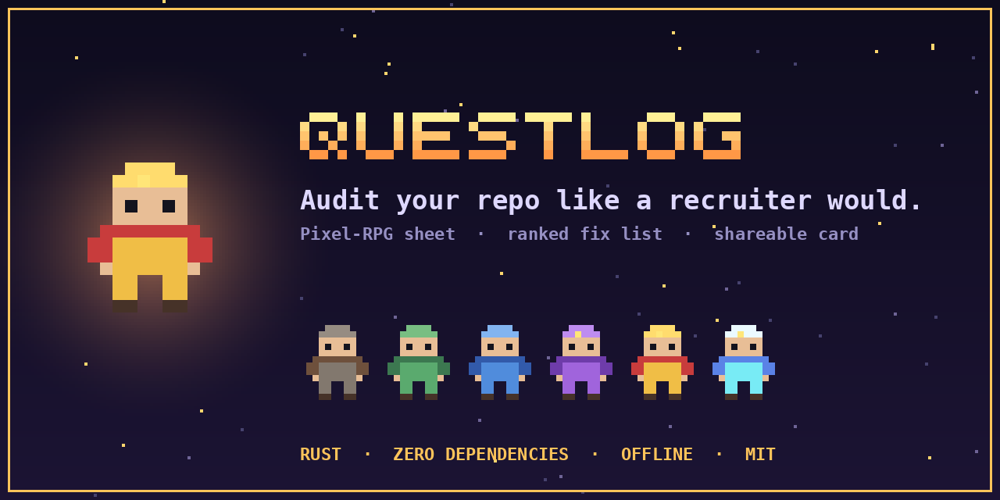
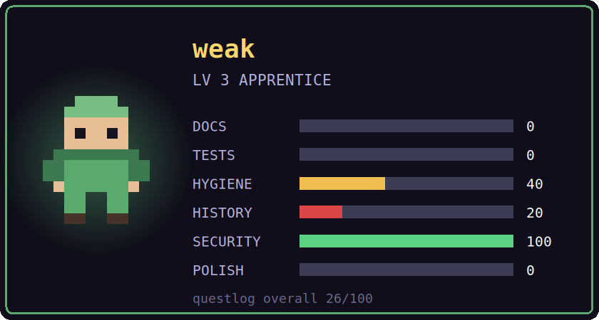
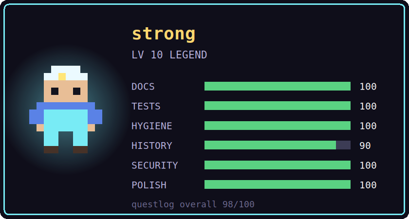
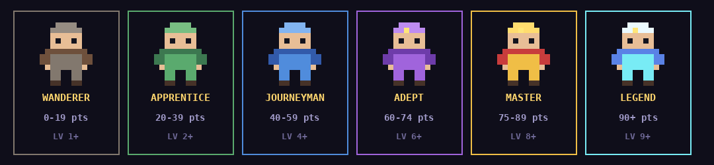
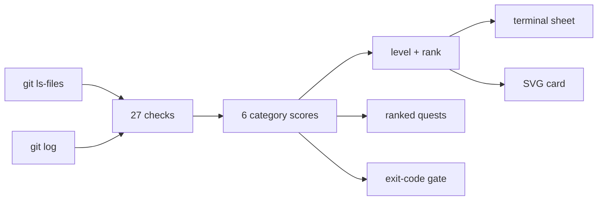

<p align="center">
  
</p>

<p align="center">
  <a href="https://github.com/ProportanilityConstant/questlog/actions/workflows/ci.yml"></a>
  
  
  
  
</p>

<p align="center">
  <b>questlog</b> audits a git repository the way a reviewer skims it, then shows the result as a pixel-RPG character sheet with a fix list ranked by score gain.<br>
  One command. Offline. No dependencies.
</p>

<p align="center">
  <a href="#install">Install</a> ·
  <a href="#usage">Usage</a> ·
  <a href="#what-it-checks">Checks</a> ·
  <a href="#how-it-works">How it works</a> ·
  <a href="#built-with">Built with</a> ·
  <a href="#limits">Limits</a>
</p>

---

## Why

A hiring manager or maintainer decides in seconds whether a repo is worth opening. The signals are predictable: a real README, tests that run in CI, a license, readable commit messages, no leaked secrets, a tagged release. Most portfolio repos miss several of them and never find out why they get skipped.

questlog checks those signals and tells you what to fix first.

## What you get

| | |
|---|---|
| **Character sheet** | Six stat bars (docs, tests, hygiene, history, security, polish), an overall score, a level, and a rank. The pixel avatar upgrades with your rank. |
| **Ranked quests** | Every failed check, sorted by score gain. The top line is the best use of your next hour. |
| **Shareable card** | `--svg card.svg` writes a card for your profile README. |
| **CI gate** | `--min-score 70` exits non-zero below your threshold. |
| **Private by design** | Reads only git-tracked files, offline. Nothing is uploaded. |

<p align="center">
  
  
</p>

### The rank ladder

<p align="center"></p>

## Install

- **Windows:** download `questlog-x64.msi` from the latest [Release](../../releases). It installs to Program Files, adds questlog to PATH (open a new terminal), and adds a Start menu entry.
- **Any OS:** install [Rust](https://rustup.rs), then run `cargo install --path .` in this folder.
- **Requires:** `git` on PATH, and a terminal with ANSI color (Windows Terminal, iTerm2, GNOME Terminal, and similar).

## Usage

```
questlog                          # audit the repo in the current folder
questlog ../other-project         # audit another folder
questlog --svg card.svg           # also write a shareable SVG card
questlog --min-score 70           # exit code 1 if the score is below 70
questlog --no-anim --version      # plain output / print version
```

Typical loop: run it, fix the top quest, commit, run it again.

Add the card to your README:

```markdown

```

Use it as a CI gate (GitHub Actions):

```yaml
- uses: actions/checkout@v4
  with:
    fetch-depth: 0
- run: cargo install --git https://github.com/ProportanilityConstant/questlog
- run: questlog . --no-anim --min-score 70
```

## What it checks

27 checks in 6 categories. Each category totals 100 points; the overall score is the average.

| Category | Checks (points) |
|---|---|
| **DOCS** | README exists (30) · 1500+ characters (20) · 3+ headings (15) · code block (15) · screenshot (10) · install/usage section (10) |
| **TESTS** | tests exist (40) · 3+ test files (20) · tests run in CI (40) |
| **HYGIENE** | LICENSE (25) · .gitignore (20) · dependency manifest (15) · no tracked build output or `.env` (25) · no file over 5 MB (15) |
| **HISTORY** | under git (20) · 10+ commits (20) · 30+ commits (10) · spans 2+ weeks (20) · descriptive messages (30) |
| **SECURITY** | no private key (40) · no AWS or GitHub token pattern (40) · `.env` untracked (20) |
| **POLISH** | CI present (30) · CHANGELOG or CONTRIBUTING (15) · badges (15) · visual assets (15) · release tag (25) |

## How it works



Sample plain output:

```
LV 10  LEGEND

DOCS     ████████████████████ 100
TESTS    ████████████████████ 100
HYGIENE  ████████████████████ 100
HISTORY  ██████████████████░░  90
SECURITY ████████████████████ 100
POLISH   ████████████████████ 100

OVERALL  98/100

QUESTS  (ranked by score gain)
  +2  XP  [HISTORY] Keep committing in small steps: 30+ commits
```

## Built with

| | |
|---|---|
| **Rust** | The whole tool: audit engine, terminal renderer, SVG writer. About 260 lines, `std` only, zero crates. |
| **WiX Toolset 5** | Windows MSI installer (`installer/`). |
| **GitHub Actions** | CI on Linux, Windows, and macOS; MSI build on release tags. |
| **SVG** | Card and logo output, drawn as pixel rectangles (no fonts needed). |

Design choices: no dependencies, so it builds anywhere in seconds and has nothing to audit. Truecolor ANSI and Unicode half-blocks for the terminal art. Windows console is switched to UTF-8 and VT mode at startup.

```
src/main.rs                 audit engine, renderer, CLI
build.rs                    embeds the Windows icon and version info
installer/questlog.wxs      MSI definition
.github/workflows/          ci.yml, release.yml
assets/                     logo, banner, rank ladder, example cards
```

## Limits

- Heuristics, not truth. A high score means a repo looks maintained; it says nothing about code quality.
- Secret detection covers private-key blocks, AWS key IDs, and GitHub tokens only. Use a dedicated scanner for real security audits.
- History checks need real history. Backdating commits is easy to spot and defeats the point.
- The checks reflect one author's view of what reviewers look for and are not validated against hiring outcomes.

## Contributing

See [CONTRIBUTING.md](CONTRIBUTING.md). New checks must keep each category at 100 points; a unit test enforces it.

## License

MIT. See [LICENSE](LICENSE).
