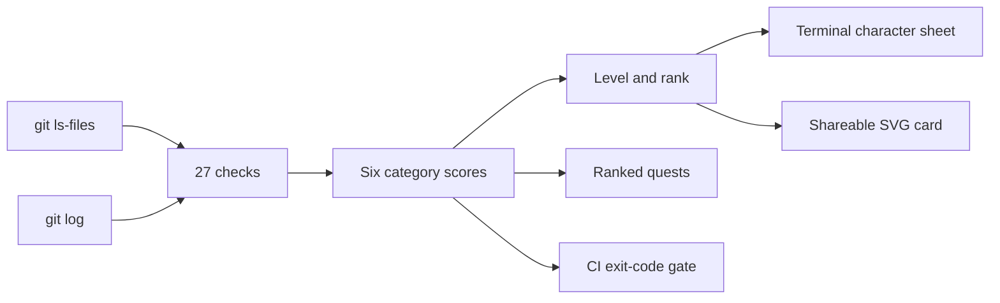

<p align="center">
  
</p>

<p align="center">
  
</p>

<p align="center">
  <a href="https://github.com/pactender/questlog/actions/workflows/ci.yml"></a>
  
  
  
  
</p>

<p align="center">
  <strong>Repository quality, turned into a quest log.</strong><br>
  A fast, offline CLI that audits the signals reviewers notice first, then turns the results into a pixel-RPG character sheet and a ranked fix list.
</p>

<p align="center">
  <a href="#quick-start">Quick start</a> ·
  <a href="#what-it-checks">Checks</a> ·
  <a href="#how-it-works">How it works</a> ·
  <a href="#built-with">Built with</a> ·
  <a href="#privacy">Privacy</a>
</p>

## Why questlog?

A repository is often judged before anyone reads the implementation. Reviewers look for the same visible signals: a clear README, working tests, CI, a license, sensible history, clean repository hygiene, and evidence that the project is maintained.

`questlog` measures those signals locally and tells you what to improve next. It is deliberately opinionated, transparent, and small enough to understand in one sitting.

## What you get

| Feature | What it does |
| --- | --- |
| **Character sheet** | Shows six category scores, an overall score, level, rank, and a pixel avatar that evolves with the result. |
| **Ranked quests** | Turns failed checks into an ordered backlog, prioritised by potential score gain. |
| **Shareable SVG card** | Writes a self-contained card you can add to a profile README, project page, or release note. |
| **CI quality gate** | Exits non-zero below a threshold such as `--min-score 70`. |
| **Offline by design** | Reads local repository files and Git history only. No telemetry, account, server, or upload. |

<p align="center">
  
  
</p>

### The rank ladder

<p align="center"></p>

## Quick start

### Install from source

Install [Rust](https://rustup.rs), clone the project, and install the binary:

```bash
git clone https://github.com/pactender/questlog.git
cd questlog
cargo install --path .
```

### Run an audit

```bash
questlog                         # audit the current repository
questlog ../other-project        # audit another repository
questlog --no-anim               # plain output for logs and CI
questlog --svg card.svg          # write a shareable SVG card
questlog --min-score 70          # fail when the score is below 70
questlog --version               # print the installed version
```

A practical loop is simple: run `questlog`, complete the highest-value quest, commit the improvement, and run it again.

Add a generated card to your README with:

```markdown

```

### Use it in GitHub Actions

```yaml
- uses: actions/checkout@v4
  with:
    fetch-depth: 0

- run: cargo install --git https://github.com/pactender/questlog
- run: questlog . --no-anim --min-score 70
```

For Windows users, the tagged release workflow also builds a native MSI installer.

## What it checks

`questlog` currently evaluates 27 checks across six categories. Each category is scored out of 100; the overall score is their average.

| Category | Signals |
| --- | --- |
| **DOCS** | README presence and depth, headings, code examples, screenshots, and install/usage guidance |
| **TESTS** | Test files, broader test coverage, and tests running in CI |
| **HYGIENE** | License, ignore rules, dependency manifest, tracked build output, secrets files, and oversized files |
| **HISTORY** | Git history, commit count, descriptive messages, and history spanning multiple weeks |
| **SECURITY** | Private-key blocks, common AWS/GitHub token patterns, and tracked `.env` files |
| **POLISH** | CI, project guidance, badges, visual assets, and release tags |

These are useful repository heuristics, not a judgement of code quality or hiring potential. The checks are intentionally visible in `src/main.rs` so the scoring is easy to inspect and discuss.

## How it works



The audit engine reads tracked files, selected file contents, and commit timestamps and subjects. It skips symlinks and common build/cache directories. The terminal renderer and SVG writer use the same score model, so the visual output always reflects the audit result.

## Built with

| Layer | Technology | Role |
| --- | --- | --- |
| **Core application** | Rust 2021 | Audit engine, CLI parsing, terminal renderer, and SVG generation |
| **Runtime** | Rust standard library | No third-party runtime dependencies; fast builds and a small attack surface |
| **Windows packaging** | WiX Toolset 5 | Native `.msi` installer built on release tags |
| **Automation** | GitHub Actions | Cross-platform tests, release builds, and the self-audit quality gate |
| **Visual system** | SVG + pixel art PNG assets | Logo, social preview, rank ladder, and score-card examples |
| **Project docs** | Markdown + Mermaid | Product overview, architecture, contribution, and security guidance |

The implementation is intentionally dependency-free. The repository is primarily Rust, with SVG, PNG, YAML, Markdown, and WiX installer definitions supporting the distribution experience.

## Repository layout

```text
src/main.rs                 audit engine, CLI, terminal renderer, SVG writer
build.rs                    Windows version and icon metadata
installer/questlog.wxs      WiX installer definition
.github/workflows/          CI and tagged-release workflows
.github/ISSUE_TEMPLATE/     Structured issue forms
assets/                     Logo, banner, social preview, cards, rank ladder
CONTRIBUTING.md             Contribution expectations
SECURITY.md                 Privacy model and vulnerability reporting
```

## Privacy

- Runs entirely on your machine: **no network access, telemetry, accounts, or data sharing**.
- Reads only Git-tracked files plus commit timestamps and subjects.
- Never reads commit author names or email addresses.
- Writes nothing unless `--svg <file>` is supplied.
- Never follows symlinks outside the repository.
- The generated SVG contains only a sanitized folder name and scores.

Read [SECURITY.md](SECURITY.md) for the complete data-handling model and private vulnerability-reporting path.

## Contributing

Contributions are welcome when they keep the tool understandable and the scoring model defensible. Start with [CONTRIBUTING.md](CONTRIBUTING.md), run the test suite, and explain why a new check is a signal a reviewer would reasonably care about.

## License

MIT. See [LICENSE](LICENSE).
